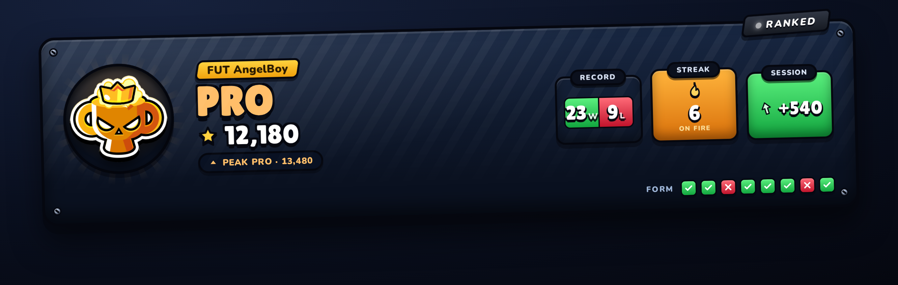
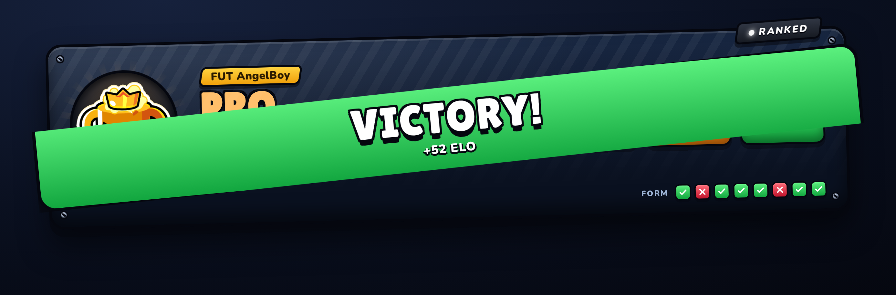
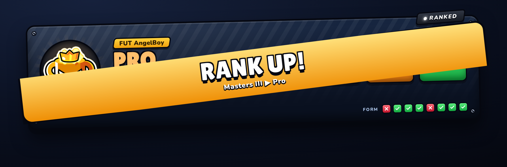
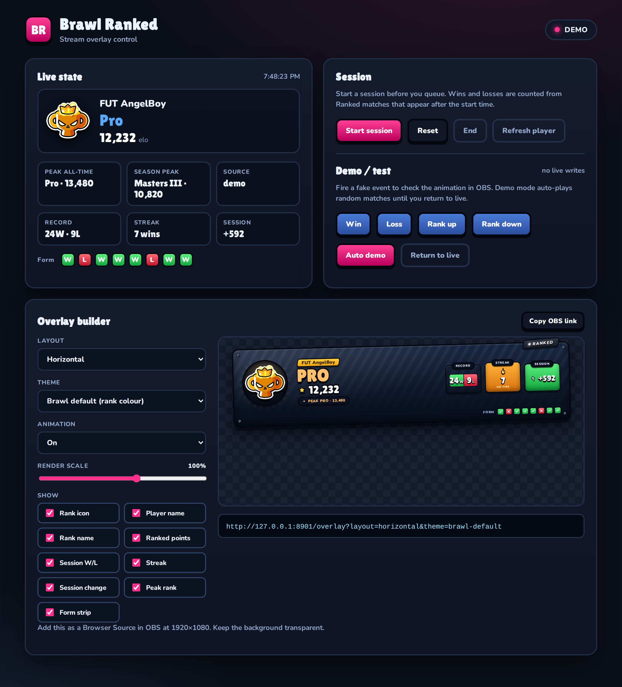
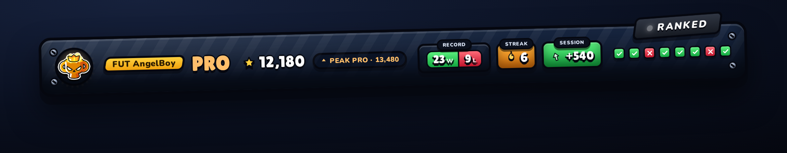
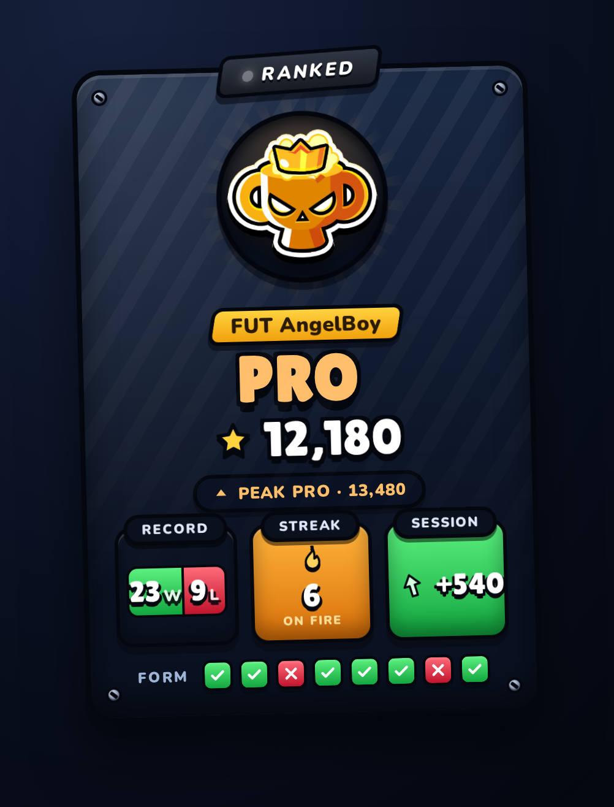
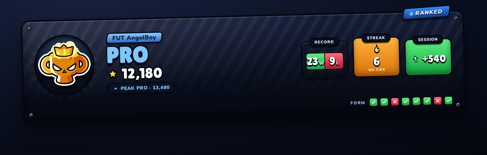
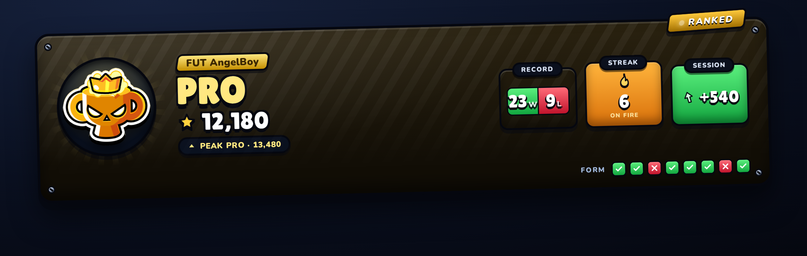
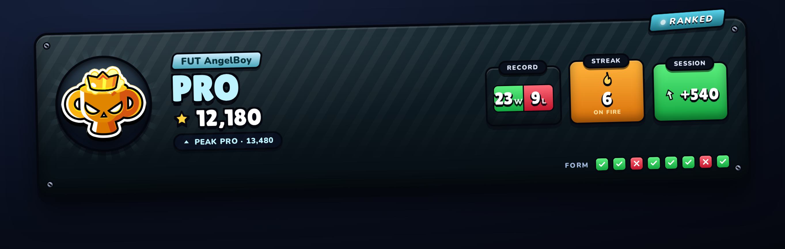
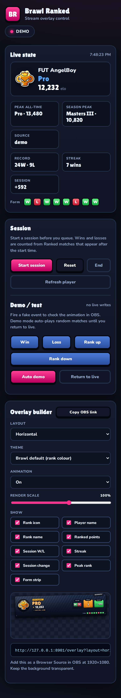

<div align="center">

# Brawl Ranked Overlay

**A live Brawl Stars Ranked overlay for OBS. One command to install, your Elo and rank on screen in about a minute.**

[](LICENSE)
[](https://nodejs.org)
[](#technical-notes)
[](#add-it-to-obs)



<sub>Screenshots use a demo account (FUT AngelBoy, Pro) so no real player is shown.</sub>

</div>

## What it does

It watches your Brawl Stars Ranked profile and draws a clean little scoreboard you can drop into your stream. It updates by itself while you play.

- Your rank emblem, from Bronze all the way to Pro
- Your in game name, current rank and exact Elo
- Your all time peak rank and Elo
- Wins, losses, current streak and your last 8 games as green and red dots
- Big animated banners when you **win**, **lose**, **rank up** or **rank down**

<div align="center">


</div>

There is also a control panel to start a session, reset it, build your overlay link, and fire test animations before you go live.

<div align="center">

</div>

### Layouts

Three shapes, same board. Horizontal is the default.

<div align="center">

<span>&nbsp;&nbsp;</span>

</div>

### Themes

Four themes. **Brawl default** takes its colours from your rank, so a Mythic board is purple, Diamond is blue, Masters is green and Pro is gold on slate.

<div align="center">



</div>

You can also turn off any piece you do not want (the rank icon, the player name, the form strip, and so on). The board reflows to close the gap.

---

## Install (the easy way)

Open a terminal and paste this one line. That is the whole install.

```bash
curl -fsSL https://raw.githubusercontent.com/orev7s/brawl-ranked-overlay/main/install.sh | bash
```

It will check if you have **Git** and **Node.js** and install them if you don't, download this project, ask for your player tag and API key, check they actually work, and then start the overlay. When it finishes it prints a link to paste into OBS.

> **Windows:** install [Git for Windows](https://git-scm.com/download/win) (you can also run `winget install Git.Git`), open **Git Bash**, and paste the same one line. Git Bash gives you the terminal the script needs.

Want a different folder or port? Add flags:

```bash
curl -fsSL https://raw.githubusercontent.com/orev7s/brawl-ranked-overlay/main/install.sh | bash -s -- --dir ~/my-overlay --port 8786
```

Already installed? Run the same command again (or `./install.sh` inside the folder) to update and restart. Your settings are kept.

### Get your API key

You need a free key from Supercell. It takes a minute.

1. Go to **https://developer.brawlstars.com** and log in with your Supercell ID.
2. Click **Create New Key** and give it any name.
3. It asks for an **allowed IP**. Your key only works from one address, so put in your **current public IP**. The page shows it for you, or Google "what is my IP".
4. Copy the long token it gives you (it starts with `eyJ`). The installer will ask for it.

You also need your **player tag**. Open Brawl Stars, tap your profile, and copy the tag under your name. It looks like `#2PQ0LRVGR`.

### Add it to OBS

1. Add a **Browser** source.
2. Set the size to **1920 x 1080**.
3. Paste the overlay link the installer printed (`http://localhost:8786/overlay`).
4. Leave the background transparent. Done.

<div align="center">

<span>&nbsp;&nbsp;</span>

</div>

---

## Make it yours

The overlay link takes options. Add them after `?` and join more than one with `&`. The **Overlay builder** in the control panel does this for you and prints a ready-to-paste link.

Example: `http://localhost:8786/overlay?layout=vertical&theme=frost&renderScale=120`

| Option | Default | What it does |
| --- | --- | --- |
| `layout` | `horizontal` | `horizontal`, `compact` or `vertical` |
| `theme` | `brawl-default` | `brawl-default`, `midnight`, `gold-rush` or `frost` |
| `motion` | `normal` | `off` to stop every animation, `normal` to keep them |
| `renderScale` | `100` | `30` to `150`, in percent |
| `align` | `top-left` | `top-left`, `top-right`, `bottom-left`, `bottom-right` |
| `x` / `y` | `48` / `44` | Distance from the corner, in pixels |
| `debug` | hidden | `1` shows a small status pill |

Every piece of the board can be switched off by setting it to `0`. The rest reflows, so nothing is left empty.

| Block | Option | Block | Option |
| --- | --- | --- | --- |
| Rank icon | `icon=0` | Session change | `change=0` |
| Player name | `name=0` | Peak rank | `peak=0` |
| Rank name | `rank=0` | Recent form strip | `form=0` |
| Ranked points | `points=0` | Session W/L | `record=0` |
| Streak | `streak=0` | | |

### Control panel

After install, open the control link it printed. From there you can:

- **Start session** to begin counting wins and losses from that moment
- **Reset** or **End** the session
- **Refresh player** to pull the latest data immediately
- Hit **Win / Loss / Rank up / Rank down** to preview the animations with fake data
- Turn on **Auto demo** to let it play random matches by itself

Nothing in the demo section touches your real stats.

### If something looks wrong

- **"WAITING FOR PLAYER"** means no data yet. Open the control panel and press **Refresh player**.
- **Nothing loads** means the key was rejected. The most common reason is the IP: your key only works from the IP you entered on the developer site, and home internet IPs change. If your stream machine moved networks, make a new key with the new IP.
- **Stats feel stale** because the game only exposes your last 25 Ranked games and this polls every 20 seconds. Two games finishing inside one poll can hide the older one.

---

## Technical notes

This part is for people who want to read or change the code.

**Stack:** plain Node.js (no dependencies) and vanilla JS. The server polls the official Brawl Stars API, holds session state, and streams updates to the browser over Server Sent Events. The API token never leaves the server.

**Layout:**

```
server/
  index.js       entry point, starts the HTTP server and poller
  config.js      reads .env
  brawlApi.js    API client
  matches.js     battlelog parsing and win/loss rules
  session.js     session record and streaks
  rank.js        the full 22 rank ladder, Elo to rank
  engine.js      ties it together, detects wins/losses/rank changes
  poller.js      the poll loop, emits state
  http.js        routes, SSE stream, static files
public/
  overlay.html / control.html
  css/  base.css, overlay.css, control.css
  js/   overlay.js, render.js, themes.js, celebrations.js, api.js, format.js, control.js
  ranks/  tier emblems
  assets/ fonts
```

**Themes and layouts:** `public/js/themes.js` holds the fixed palettes. `brawl-default` is special: it reads `rank.color / edge / deep` from the current rank, so its accent and ribbon change with the emblem. Layouts are plain CSS on `[data-layout]` in `public/css/overlay.css`. Display blocks are `[data-block]` elements hidden by `[data-*="0"]` rules.

**Environment variables** (`.env`):

| Name | Meaning |
| --- | --- |
| `BRAWL_API_TOKEN` | Your API key. Required for live mode. |
| `PLAYER_TAG` | The player to track, with the `#`. |
| `PORT` | HTTP port, default `8786`. |
| `POLL_MS` | Poll interval in ms, minimum `15000`. |
| `CONTROL_TOKEN` | Optional. Locks the control panel and action endpoints behind `?key=`. |
| `DEMO` | `1` starts in demo mode, no API calls. |
| `DEMO_NAME` / `DEMO_ELO` | Optional. The name and Elo a demo board starts from. |
| `DEMO_FREEZE` | `1` keeps a demo board still (no auto-played matches), handy for screenshots. |
| `DATA_DIR` | Optional. Where `session.json` lives, so a second instance can run beside the live one. |
| `OVERLAY_CREDIT` | Optional small label in the corner. |

**How a result is decided:** Ranked 3v3 uses `battle.result`. Ranked showdown has no result field, so a win is a positive `trophyChange`, falling back to a top half placement. The Elo delta shown on a banner is the change between the previous poll and the current one.

**The rank ladder** lives in `server/rank.js`. Supercell does not publish these numbers, so they come from the community checked table:

```
Bronze I 0, II 250, III 500
Silver I 750, II 1000, III 1250
Gold I 1500, II 2000, III 2500
Diamond I 3000, II 3500, III 4000
Mythic I 4500, II 5000, III 5500
Legendary I 6000, II 6750, III 7500
Masters I 8250, II 9250, III 10250
Pro 11250 (no divisions)
```

**Run from source:**

```bash
git clone https://github.com/orev7s/brawl-ranked-overlay.git
cd brawl-ranked-overlay
cp .env.example .env      # then edit it
node server/index.js      # or DEMO=1 node server/index.js
```

**HTTP endpoints:**

```
GET  /api/state                     current snapshot as JSON
GET  /api/stream                    live updates (SSE)
POST /api/session/start|reset|end|refresh
POST /api/demo   { "action": "win" | "loss" | "rankup" | "rankdown" }
POST /api/demo   { "enabled": true | false }
```

Session and demo endpoints need `?key=CONTROL_TOKEN` when a control token is set. The session is saved to `data/session.json` so a restart does not lose it.

---

<div align="center">

**Fan made.** Not affiliated with or endorsed by Supercell. Rank emblems and fonts belong to their owners.

</div>
